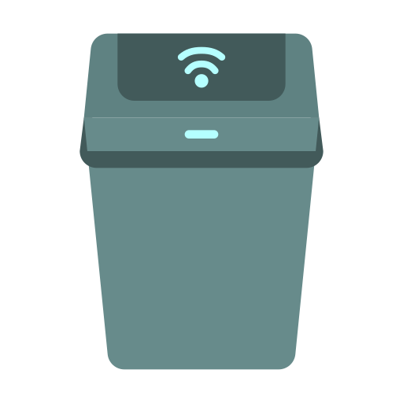
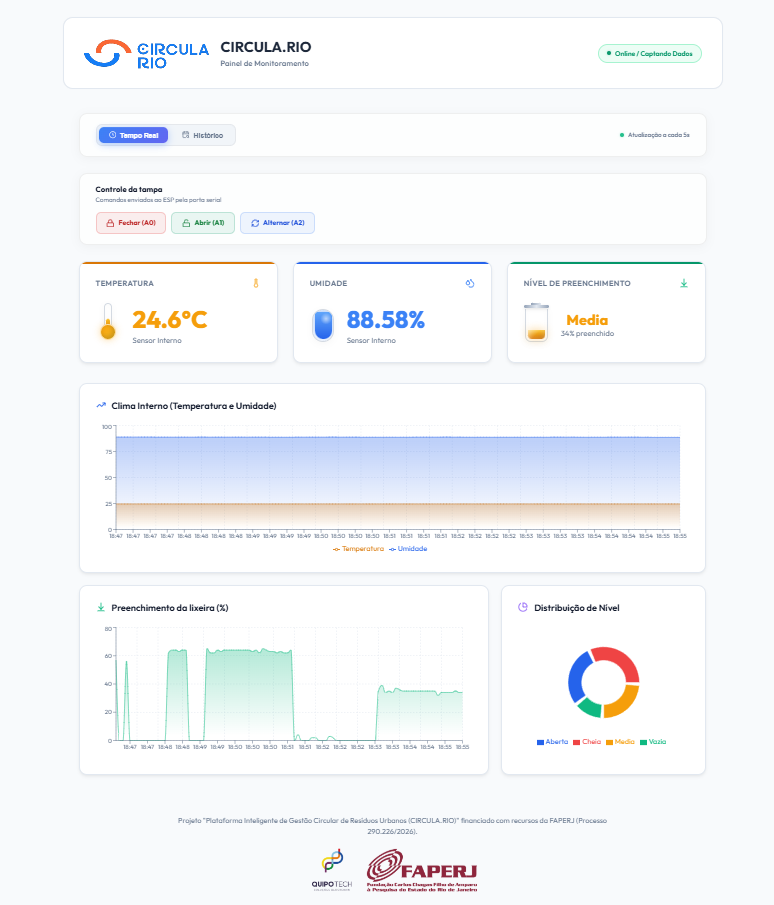
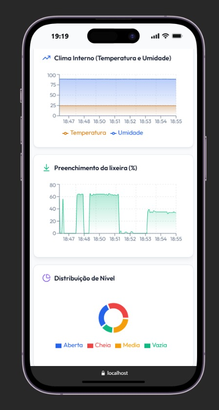
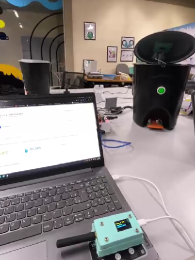
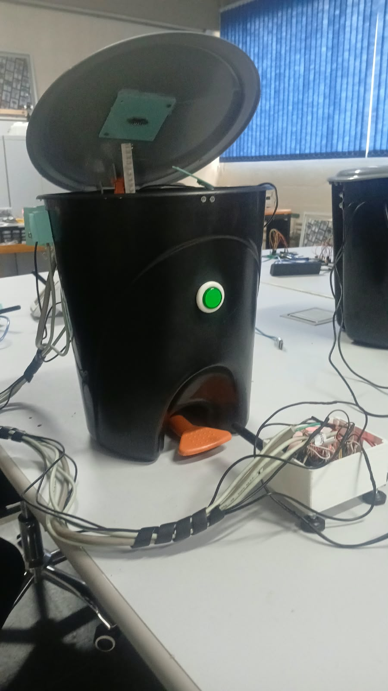

# CIRCULA.RIO

## Plataforma Inteligente de Gestao Circular de Residuos Urbanos

Dashboard de monitoramento ambiental para uma lixeira inteligente conectada a um ESP com LoRa. O sistema recebe as leituras pela porta serial, envia os dados para uma API local, grava as medicoes em SQLite e exibe os dados em uma interface React.

Projeto financiado com recursos da FAPERJ (Processo 290.226/2026).

<p align="center">
  
</p>

<p align="center">
  <strong>Monitoramento ambiental em tempo real para uma lixeira inteligente conectada por ESP e LoRa.</strong>
</p>

## Visao do projeto

<p align="center">
  
</p>

O CIRCULA.RIO integra sensores ambientais, comunicacao LoRa e um painel web para acompanhar o preenchimento da lixeira, temperatura e umidade. O sistema tambem oferece controles para a tampa quando o firmware do ESP estiver preparado para receber os comandos.

## Demonstracao

### Dashboard desktop

<p align="center">
  
</p>

### Dashboard em dispositivo movel

<p align="center">
  
</p>

### Prototipo em funcionamento

<p align="center">
  
  
</p>

## Arquitetura

```text
ESP + LoRa
   |
   | JSON pela porta serial (COM, 9600 baud)
   v
esp_bridge.js
   |
   | POST /api/sensores
   v
server.js / Express (porta 3001)
   |
   v
SQLite (backend/sensores.db)
   |
   | GET /api/sensores e GET /api/sensores/atual
   v
Frontend React + Vite (porta 5173)
```

Os comandos da tampa seguem o caminho inverso:

```text
Interface -> API Express (3001) -> bridge do ESP (3002) -> porta serial -> ESP
```

## Requisitos

- Windows com PowerShell.
- Node.js instalado. O projeto foi validado com Node.js 22.
- npm instalado.
- ESP conectado ao computador por USB.
- Driver USB/serial do ESP instalado, quando necessário.
- Dependencias do backend e frontend instaladas com `npm install`.

## Estrutura do projeto

```text
backend/
  database.js       Banco SQLite e criacao/migracao da tabela.
  esp_bridge.js     Leitura da COM e envio de comandos ao ESP.
  server.js         API Express e proxy de comandos.
  list_ports.js     Lista portas seriais disponiveis.
  fix_db.js         Utilitario legado para ajuste de datas.
  package.json
  sensores.db       Banco local criado em tempo de execucao.

frontend/
  src/
    App.jsx         Tela principal e controles da tampa.
    index.css       Estilos do dashboard.
    components/
      DashboardCards.jsx
      Charts.jsx
  public/
    favicon.svg
  package.json

README.md
```

## Instalacao

Abra um terminal na pasta do projeto:

```powershell
cd "C:\Users\gustavo.freitas\Desktop\Dashboard-Lixeira\Dashboard-Lixeira"
```

Instale as dependencias do backend:

```powershell
cd backend
npm install
```

Instale as dependencias do frontend em outro terminal ou depois:

```powershell
cd "C:\Users\gustavo.freitas\Desktop\Dashboard-Lixeira\Dashboard-Lixeira\frontend"
npm install
```

## Configuracao da porta COM

A porta do ESP fica definida diretamente no codigo em [backend/esp_bridge.js](backend/esp_bridge.js):

```js
const ESP_PORT = 'COM3';
```

Troque `COM3` pela porta do seu ESP, por exemplo:

```js
const ESP_PORT = 'COM5';
```

Para listar as portas reconhecidas pelo Windows:

```powershell
cd backend
node list_ports.js
```

O baud rate atual e `9600`:

```js
const BAUD_RATE = Number(process.env.BAUD_RATE || 9600);
```

Ele deve ser igual ao baud rate configurado no firmware do ESP.

## Como executar

Sao necessarios tres processos em tres terminais separados.

### 1. API e banco

```powershell
cd "C:\Users\gustavo.freitas\Desktop\Dashboard-Lixeira\Dashboard-Lixeira\backend"
npm run server
```

A API fica em:

```text
http://localhost:3001
```

### 2. Bridge serial do ESP

Com o ESP conectado e a porta configurada:

```powershell
cd "C:\Users\gustavo.freitas\Desktop\Dashboard-Lixeira\Dashboard-Lixeira\backend"
npm run esp
```

Mensagens esperadas:

```text
ESP conectado na porta COM3 a 9600 baud.
Aguardando JSON do ESP. API: http://localhost:3001/api/sensores
```

Quando uma leitura chegar:

```text
JSON recebido do ESP: { ... }
Dados do ESP salvos no banco e disponíveis no dashboard.
```

### 3. Interface

```powershell
cd "C:\Users\gustavo.freitas\Desktop\Dashboard-Lixeira\Dashboard-Lixeira\frontend"
npm run dev
```

Abra no navegador:

```text
http://localhost:5173
```

A interface atualiza o modo tempo real a cada 5 segundos.

## Formato enviado pelo ESP

O firmware atual envia uma linha JSON terminada por quebra de linha, normalmente a cada 5 segundos:

```json
{
  "distancia": 49,
  "temperatura": 24.9,
  "umidade": 89.43,
  "nivel_calculado": "Medio"
}
```

Campos aceitos:

| Campo | Tipo | Descricao |
| --- | --- | --- |
| `distancia` | numero | Percentual usado pelo dashboard para o preenchimento, de 0 a 100. |
| `distancia_cm` | numero | Alias aceito pela API para compatibilidade. |
| `temperatura` | numero | Temperatura em graus Celsius. |
| `umidade` | numero | Umidade relativa em porcentagem. |
| `nivel_calculado` | texto | Estado calculado pelo ESP. |
| `nivel` | texto | Alias aceito para `nivel_calculado`. |
| `device_id` | texto | Identificador opcional da lixeira. |
| `gateway_id` | texto | Identificador opcional do gateway LoRa. |
| `bateria` | numero | Bateria opcional em porcentagem. |
| `rssi` | numero | RSSI opcional do sinal LoRa. |
| `snr` | numero | SNR opcional do sinal LoRa. |

Estados reconhecidos no dashboard:

- `Vazia`
- `Media` ou `Medio` (a API normaliza `Medio` para `Media`)
- `Cheia`
- `Aberta` ou `Aberto`
- `Erro`

O bridge aceita JSON puro ou linhas que contenham um objeto JSON, como uma mensagem de debug antes do objeto.

## API

### Receber uma medicao

```http
POST http://localhost:3001/api/sensores
Content-Type: application/json
```

Exemplo com PowerShell:

```powershell
Invoke-RestMethod -Uri "http://localhost:3001/api/sensores" `
  -Method Post `
  -ContentType "application/json" `
  -Body '{"distancia":49,"temperatura":24.9,"umidade":89.43,"nivel_calculado":"Medio"}'
```

### Buscar historico

Ultimas 100 medicoes:

```text
GET http://localhost:3001/api/sensores
```

Por periodo, usando `datetime-local`:

```text
GET http://localhost:3001/api/sensores?start=2026-10-16T08:00&end=2026-10-16T18:00
```

### Buscar medicao atual

```text
GET http://localhost:3001/api/sensores/atual
```

### Enviar comando para o ESP

```http
POST http://localhost:3001/api/esp/comando
Content-Type: application/json
```

Corpo:

```json
{"comando":"A0"}
```

Comandos aceitos pelo backend/bridge:

| Comando | Acao esperada |
| --- | --- |
| `A0` | Fechar a tampa. |
| `A1` | Abrir a tampa. |
| `A2` | Alternar a tampa. |

Importante: o firmware ESP atualmente analisado envia as medicoes, mas ainda nao possui tratamento para `A0`, `A1` e `A2`. O projeto consegue enviar esses comandos pela COM, mas o ESP so executara as acoes depois que o firmware implementar esses comandos.

## Banco de dados

O SQLite fica em:

```text
backend/sensores.db
```

Tabela principal: `medicoes`.

Colunas:

- `id`
- `device_id`
- `gateway_id`
- `temperatura`
- `umidade`
- `distancia`
- `nivel_calculado`
- `bateria`
- `rssi`
- `snr`
- `data`

Para limpar todas as medicoes e manter a estrutura da tabela:

```powershell
cd backend
node -e "const db=require('./database'); db.run('DELETE FROM medicoes', function(err){ if(err){ console.error(err.message); process.exitCode=1; return; } console.log('Registros removidos:', this.changes); db.close(); });"
```

Essa operacao e irreversivel. Faca uma copia de `sensores.db` antes se precisar preservar o historico.

## Comandos npm

### Backend

```powershell
npm run server
```

Inicia a API Express na porta `3001`.

```powershell
npm run esp
```

Inicia o bridge serial do ESP e o servidor interno de comandos na porta `3002`.

```powershell
npm test
```

Valida a sintaxe de `server.js` e `esp_bridge.js`.

### Frontend

```powershell
npm run dev
```

Inicia o Vite em modo desenvolvimento.

```powershell
npm run build
```

Gera a versao de producao em `frontend/dist`.

```powershell
npm run preview
```

Serve o build de producao localmente.

```powershell
npm run lint
```

Executa o Oxlint configurado no frontend.

## Solucao de problemas

### `fetch failed` no bridge

O ESP foi lido, mas a API nao respondeu. Verifique se o terminal do backend mostra:

```text
Servidor backend rodando na porta 3001
```

Inicie:

```powershell
cd backend
npm run server
```

### `Nenhuma porta serial encontrada`

- Conecte o ESP por USB.
- Confira o driver USB/serial.
- Execute `node list_ports.js`.
- Confirme `ESP_PORT` em `backend/esp_bridge.js`.

### `Access denied` ou porta ocupada

Somente um processo pode abrir a COM. Feche outro monitor serial, Arduino IDE ou outra instancia de `npm run esp` antes de iniciar o bridge.

### O bridge abre a COM, mas nao recebe dados

- Confirme que o firmware usa `Serial.begin(9600)`.
- Confirme que o ESP envia `Serial.println(json)` com `\\n` no final.
- Confirme que o JSON e valido.
- Verifique se a porta configurada e a mesma mostrada pelo `list_ports.js`.

### O dashboard abre, mas fica sem dados

- Confirme que `npm run server` esta ativo.
- Confirme que `npm run esp` esta ativo.
- Acesse `http://localhost:3001/api/sensores/atual`.
- Veja os logs dos dois terminais.
- Recarregue o navegador com `Ctrl + F5`.

### Os comandos da tampa nao funcionam

O bridge e a API enviam `A0`, `A1` e `A2`, mas o firmware precisa ler essas mensagens e acionar o motor. Adicione o tratamento desses comandos no ESP antes de testar os botoes do dashboard.

## Desenvolvimento e boas praticas

- Nao execute mais de um bridge na mesma porta COM.
- Mantenha o backend ativo antes do bridge.
- Use uma linha JSON por leitura.
- Inclua `device_id` quando houver mais de uma lixeira.
- Faca backup de `backend/sensores.db` antes de limpar ou migrar dados.
- Nao commite dados sensiveis ou o banco de producao.

## Licenca e identificacao

Projeto CIRCULA.RIO, desenvolvido para monitoramento inteligente e gestao circular de residuos urbanos, com apoio da FAPERJ e parceria da Quipo Tech.
